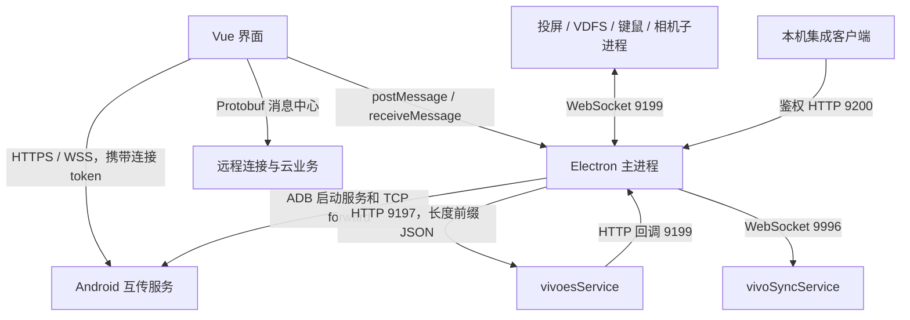

# 分析范围和架构

## 样本和结论等级

主样本为 `pcsuite/resources/app.asar`，package.json 声明 `name=pcsuite`、`version=7.0.6`、入口 `dist/electron/main.js`。ASAR SHA256 为 `35ffb46ab7979ddc5250c66393dd6fb35210739dab4fd125a94462f72a7f96e0`。同目录包含 SyncService、vivoScreen、vivoExtScreen、vdfs、vivorelay、phoneCall、vivoCamera、vivoControl，以及 `updateApk/pcsuite.apk` 和 `connbase.apk`。

本文中的“确认”表示打包 JavaScript 中存在注册、序列化或调用实现；“交叉印证”表示同一路径还出现在 Android DEX 字符串；“候选”表示仅字符串或符号线索。没有执行动态抓包或完成真机互通。返回字段以代码实际消费项为准，不表示服务端完整 schema。

## 端口与方向

| 默认端口 | 监听端或用途 | 证据和限制 |
|---|---|---|
| 2200 / UDP | vivo 局域网组播发现 | 239.255.255.250；[无线配对](wireless-pairing.md) |
| 10191 / TCP | 手机旧版无线授权 | 二进制帧 + JSON；新版兼容性待真机确认，见 [无线配对](wireless-pairing.md) |
| 9197 | PC vivoesService HTTP | [常量](../evidence/main-modules/90.js)；收发形如 `长度#JSON` 的消息 |
| 9199 | PC Electron HTTP/WS 回调服务 | [实现](../evidence/main-modules/95.js)；冲突时加 100，最多重试 6 次；`listen(port)` 没有限定 loopback 地址 |
| 9200 | PC Skill/VClaw HTTP 服务 | [实现](../evidence/main-modules/358.js)；仅绑定 127.0.0.1，冲突加 100，再失败可用系统分配端口 |
| 9996 | PC SyncService WebSocket | [常量](../evidence/main-modules/687.js)；Windows 可从配置的 SyncServicePort 读取 |
| 10380 | 手机连接 HTTP/HTTPS 与 WSS | [常量](../evidence/main-modules/90.js)、[连接代码](../analysis/pretty/app-connection.js#L14136) |
| 10381 | 手机 mirror 服务端口 | 已确认 ADB 转发；媒体帧协议未还原 |
| 5678 / 5679 | 手机 VDFS / PC VDFS 常量 | 不应假设与 HTTP 文件管理协议等价 |
| 8903 / 8904 | 手机 relay / PC relay 常量 | 键鼠业务；底层协议未还原 |
| 9198 | APP_SERVER_PORT 常量 | 仅确认常量，不能据此宣称已有可调用监听服务 |

USB 主转发默认 `PC 10380 → 手机 10380`，附加转发是 `PC P+1 → 手机 10381`、`P+2 → 5678`、`P+3 → 8903`。主端口遇到特定 Windows 占用/权限错误会按 500 递增，最多重试 5 次。不要把 PC 的 `P+2` 当成固定 5679。[实现](../evidence/main-modules/89.js#L251)

## 移植边界

JavaScript 业务层已经包含 macOS 分支，涉及资源目录、进程名称、网络权限、窗口和系统扩展。Windows `.node`、`.dll`、驱动以及独立 EXE 不能直接在其他平台载入；现有 macOS 分支也不能证明 Linux 功能完整。[构建及依赖元数据](../analysis/app/package.json)

移植应按三类处理：协议客户端重新实现 HTTP/WSS/Protobuf；平台适配重新实现 ADB、文件系统、剪贴板、通知和进程；媒体、虚拟相机、VDFS 挂载和同步引擎单独做兼容性验证。具体优先级见 [移植实施](porting.md)。
